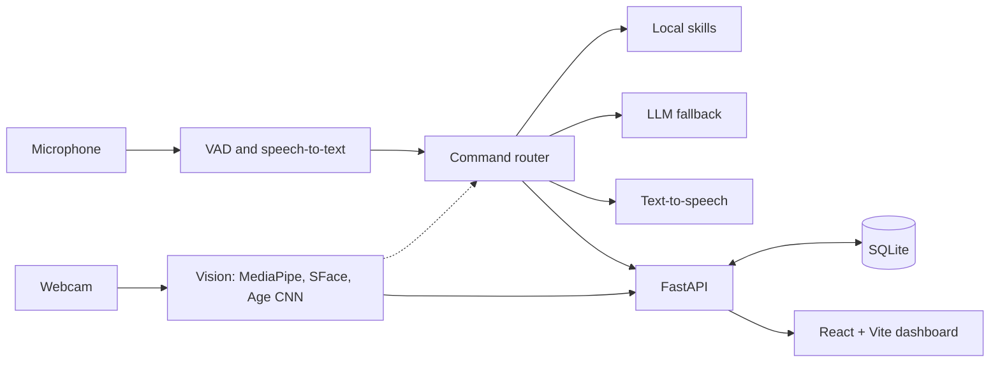

# 🤖 AI Robot — Voice + Vision Assistant

A voice-controlled assistant built end to end: you talk to it, show it things, and it answers out loud.
It combines computer vision, speech, an LLM, a REST API, a database and a React dashboard, all running on one laptop.


## Features of THIS
- **Face detection, expressions and finger counting** (MediaPipe)
- **Face recognition:** teach it your face ("remember me as Nishu") and it labels you on screen
- **Age range estimation** from a face crop
- **Continuous voice conversation:** no button presses, it listens, answers and listens again
- **LLM brain** (Gemini free tier or Claude) for open questions. Ask "what do you see?" and it sends the camera frame
- **Voice skills:** open any installed app, search Google or YouTube, take photos, time and date, jokes
- **React dashboard:** live video HUD, emotion signals, face-embedding view, analytics charts, API explorer, photo gallery, dark/light mode with accent colours, command palette (Ctrl+K)

## Tech stack
| Area | Tools |
|---|---|
| Backend | Python, FastAPI, Uvicorn, background worker threads |
| Computer vision | OpenCV, MediaPipe Face + Hand Landmarker |
| Face recognition | SFace ONNX model (128-d embeddings, cosine similarity) via OpenCV DNN |
| Age estimation | CNN classifier (ONNX) via OpenCV DNN |
| Speech | Adaptive-threshold voice activity detection, Google Web Speech, Windows SAPI |
| LLM | Gemini API (free tier) or Claude API, multimodal |
| Database | SQLite (people, history, detection logs) |
| Frontend | React 19, Vite, hand-written SVG charts |

## Architecture


## How the ML parts work
- **Expressions:** MediaPipe returns 52 facial-muscle scores (blendshapes). Simple, explainable rules turn them into Happy, Sad, Angry, Surprised or Neutral.
- **Face recognition:** each aligned 112x112 face becomes a 128-dimensional embedding. A face matches a saved person when the cosine similarity is above 0.363. Only embeddings are stored, never photos.
- **Voice:** an adaptive noise-floor VAD cuts speech out of the mic stream. The mic is muted while the robot talks so it never hears itself.
- **Commands:** regex intents answer local skills instantly. Anything else goes to the LLM with live camera context and recent conversation turns.

## Setup (Windows)
```bash
git clone https://github.com/Nishupathak/AI-Project.git
cd AI-Project/ai-robot

python -m venv venv
venv\Scripts\activate
pip install -r requirements.txt
```
1. Get a free Gemini key at aistudio.google.com/apikey and save it in a file named `api_key.txt` next to `server.py`.
2. Run the backend (the first run downloads about 70 MB of models):
```bash
python server.py
```
3. Run the frontend in a second terminal:
```bash
cd frontend
npm install
npm run dev
```
Open http://localhost:5173. Or run `npm run build` once and open http://localhost:8000 (FastAPI serves the built app).

> On Windows PowerShell, if `npm` is blocked by the execution policy, use `npm.cmd` instead.

## Try saying
| Say | Result |
|---|---|
| "count my fingers" | counts raised fingers |
| "how do I look" | tells your expression |
| "remember me as Nishu" | learns your face |
| "who am I" / "how old am I" | recognises you, guesses an age range |
| "open Telegram" | launches the app |
| "search python tutorials on Google" | opens the search |
| "what do you see" | sends the camera frame to the LLM |
| "explain gravity" | answers through the LLM |

## API
Interactive docs at `http://localhost:8000/docs`. Main endpoints: `/status`, `/system`, `/identify`, `/command`, `/people`, `/history`, `/stats`, `/detections/summary`, `/detections/timeline`, `/photos`, `/video` (MJPEG stream).

## Limitations
- Expression detection is rule-based, not a trained emotion classifier. It is fast and explainable, but coarse.
- Age is a rough range and can be off by years.
- Speech-to-text needs an internet connection.
- The free-tier LLM has rate limits. Camera frames are only sent when you ask "what do you see".
- Face embeddings are biometric data. They stay on your machine and can be deleted with "forget ...".

## Future work
Wake word ("Hey robot"), offline speech recognition, and a physical robot body with Arduino or ESP32 servos.
